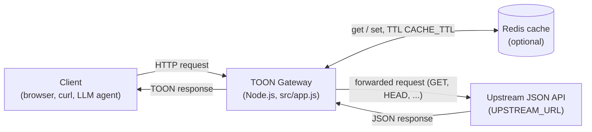
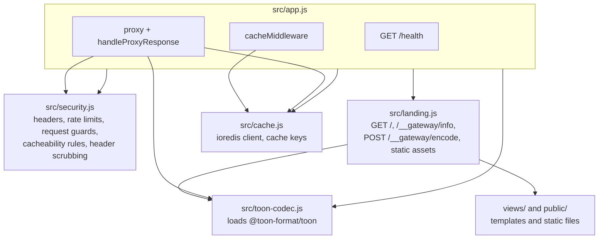
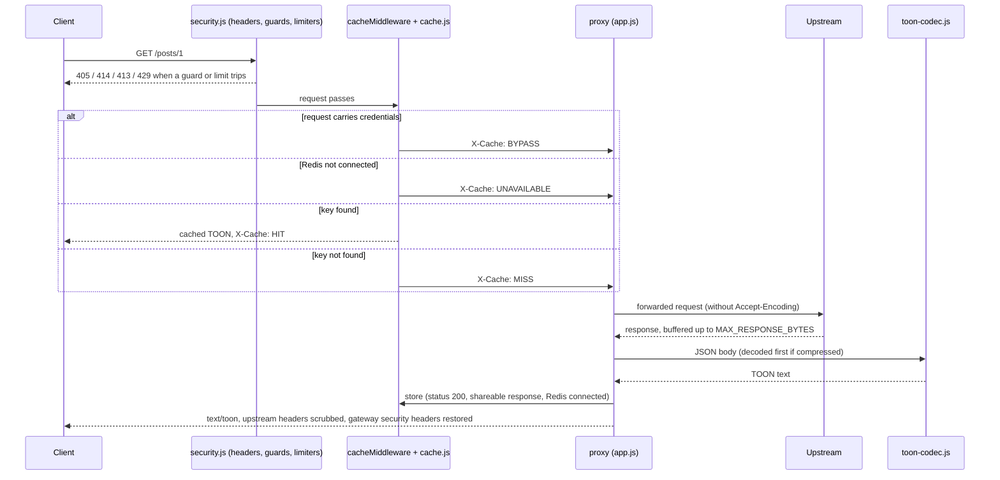

# Architecture

How the TOON Gateway is put together. For configuration and endpoints see the [README](../README.md); for hosting see [DEPLOYMENT.md](../DEPLOYMENT.md); for the security measures see [SECURITY.md](../SECURITY.md).

## System context

The gateway sits between a client and one fixed upstream API (`UPSTREAM_URL`). It returns the upstream's JSON as TOON and keeps successful responses in Redis. Redis is optional: without it the gateway still proxies and converts, uncached.

## Modules

Each box is a file in `src/` (or a folder served by `src/landing.js`). `src/app.js` wires the others together; the order of `app.use` calls in it is the order a request passes through them.

| File | Responsibility |
|---|---|
| `src/app.js` | Express app, logging (Winston, Morgan), `/health`, the cache middleware, the proxy and its response handler, error handler, graceful shutdown |
| `src/security.js` | Helmet headers and the Permissions-Policy, the three rate limiters, request guards (method allow-list, URL length, body size), the client-IP rule, what may be cached, which upstream headers are removed, `UPSTREAM_URL` validation |
| `src/landing.js` | The gateway's own endpoints under `/` and `/__gateway`: docs page (`views/index.html`, `views/usage.txt`), `GET /__gateway/info`, `POST /__gateway/encode`, `public/` assets |
| `src/cache.js` | The Redis connection, its connected/disconnected state, and the SHA-256 cache key |
| `src/toon-codec.js` | Loads the ESM-only `@toon-format/toon` once at startup; `encodeToToon` and `decodeFromToon` |
| `public/`, `views/` | Static assets (`landing.css`, `landing.js`, `favicon.svg`) and the two page templates |

## Request flow for a proxied GET

Non-JSON responses pass through unchanged. Paths handled by the gateway itself (`/`, `/health`, `/robots.txt`, `/favicon.ico`, `/__gateway/...`) are never proxied or cached.
